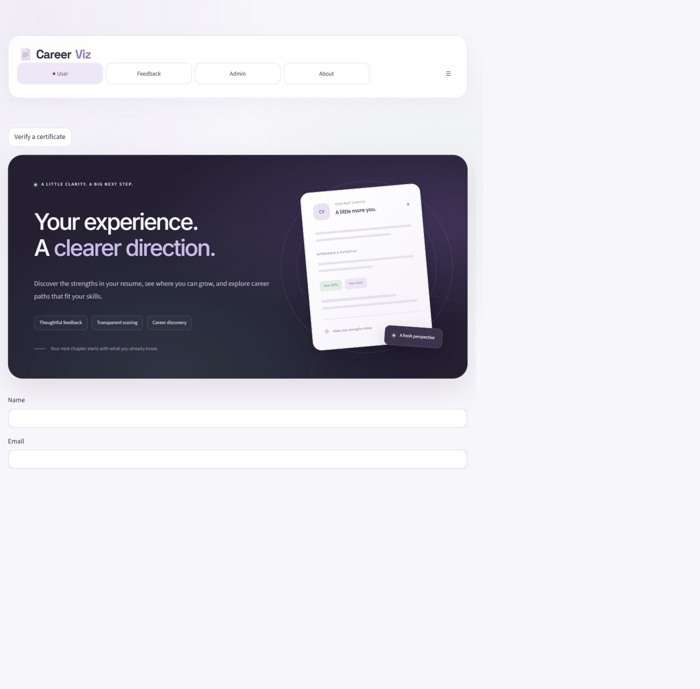
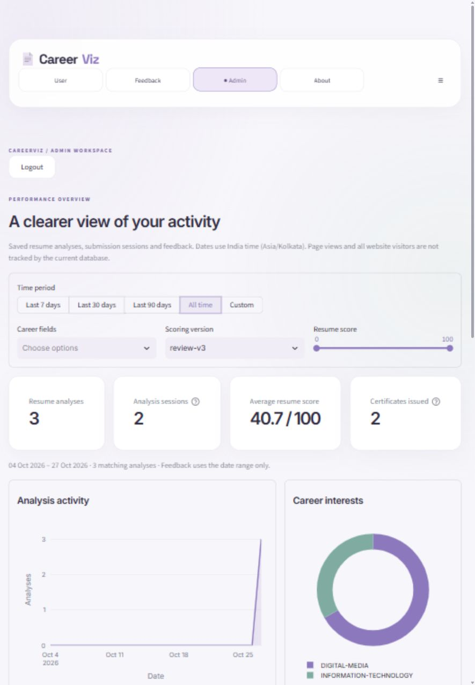
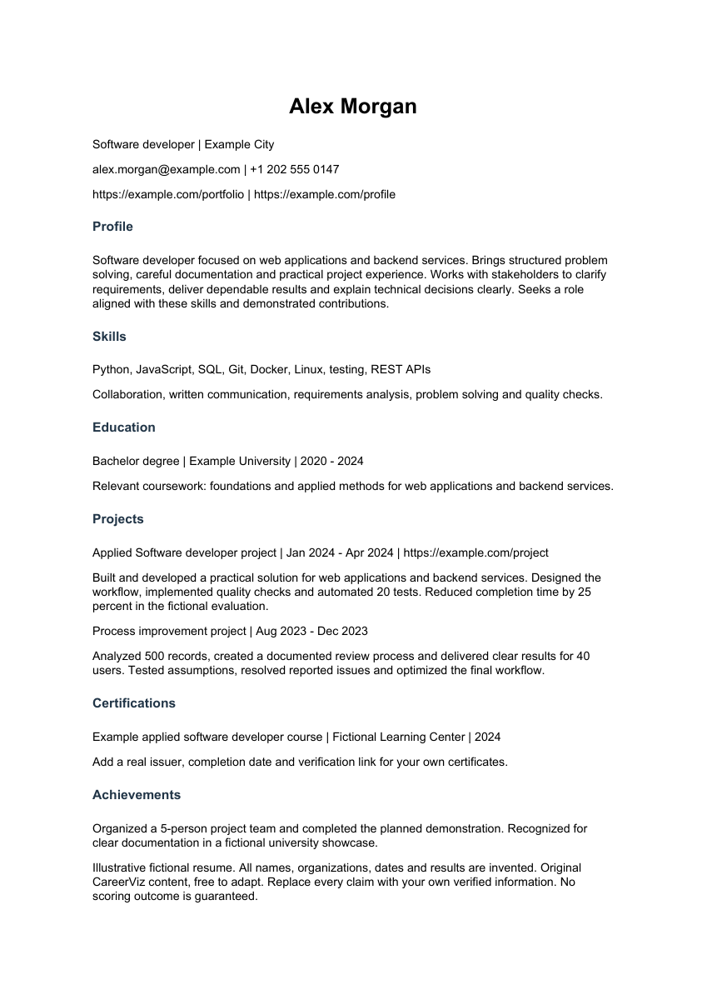

<div align="center">

# CareerViz

### Understand your resume. Discover your direction.

A resume analyzer with transparent scoring, career discovery, fictional resume formats,
verifiable certificates, and an admin analytics dashboard.

**Developed by Shubham Sharma**

[Live application](https://careerviz7217.streamlit.app/) ·
[GitHub](https://github.com/shubham-coder-ship-it) ·
[LinkedIn](https://www.linkedin.com/in/shubham-sharma-55ab97367/) ·
[GPL-3.0 licence](LICENSE)

</div>

---

## Live deployment

**Try CareerViz:** [careerviz7217.streamlit.app](https://careerviz7217.streamlit.app/)

The application is deployed on Streamlit Community Cloud. The live application
uses its own database; locally issued certificate records are not automatically
copied to the deployment. Certificate verification requires the issuing record
in the live database. Free hosting does not guarantee persistent local files.

## What CareerViz does

| Feature | What you can do |
| --- | --- |
| Resume analysis | Upload a PDF or DOCX and review extracted contacts, education and skills |
| Local OCR | Read scanned PDFs and PNG/JPG resumes on Windows using local text recognition |
| Evidence-based scoring | See a versioned score, component breakdown, strengths and improvement suggestions |
| Career discovery | Compare skills with an optional reference dataset, with term-rule fallback |
| Resume formats | Browse fictional examples by score, role, industry, experience and format |
| Reports and certificates | Download an analysis PDF and a certificate with a verification link and QR code |
| Admin analytics | Filter saved activity by date, career, score and scoring version; view charts and export records |
| Feedback moderation | Pin, review, publish or unpublish feedback |

No model training, data scaling or activation workflow is required.
Scores are assessments of documented evidence, not ATS approval, verified
qualifications or employment guarantees.

## Screenshots

### Homepage

A pearl, lavender and sage interface with a deep-plum hero and rounded panels.



### Admin analytics

Authenticated dashboard with date filters, activity cards and career charts.
This screenshot contains aggregate information, not applicants' contact details.



### Complete fictional resume format

A complete sample with contact details, profile, skills, education, projects,
certifications and achievements. All personal details and accomplishments in
this example are fictional. Replace them with your own truthful information.



## How to use

1. Open the [live application](https://careerviz7217.streamlit.app/) and select **User**.
2. Upload your resume. Fill in contact details only when they are missing or unreadable.
3. Optionally enter a target job description for a separate skill-coverage comparison.
4. Click **Analyze Resume** and review the score breakdown, career matches and suggestions.
5. Download the analysis report or certificate. Use **Reanalyze Resume** after updating your file.
6. Open **Resume format examples** to explore sample formats and the editable blank template.

For Admin, sign in to see activity charts, date filters, reference data, feedback
moderation and certificate verification. Usage charts count saved analyses and
submission sessions; they do not measure all website visitors or page views.

## Resume scoring

The current **review-v3** rubric uses these weights:

| Component | Maximum points |
| --- | ---: |
| Project quality | 25 |
| Experience quality | 20 |
| Demonstrated skills | 15 |
| Education | 10 |
| Summary and targeting | 10 |
| Formatting and readability | 10 |
| Certifications | 5 |
| Supporting evidence | 5 |
| **Total** | **100** |

Relevant contributions, documented outcomes and supporting links matter more
than merely listing sections or keywords. Text signals cannot independently
verify claims or fully judge visual design. Compare scores from the same rubric
version; older saved analyses keep their original score and version.

## Technology

**Python · Streamlit · SQLite · pandas · Plotly · pdfminer.six · ReportLab · Pillow**

Local scanned-resume support uses Windows OCR and Poppler. The current OCR helper
requires Windows; Linux cloud hosting needs a compatible OCR adapter for scanned
PDFs and images. Selectable-text PDF/DOCX processing does not require Windows OCR.

## Project structure

```text
CareerViz/
├── README.md                         # Project overview and setup
├── LICENSE                           # GNU GPL version 3
├── NOTICE.md                         # Attribution and third-party notices
├── Start-CareerViz.ps1                # Windows launcher
├── docs/
│   └── images/                       # Public interface and fictional-resume screenshots
└── AI-Resume-Analyzer/
    ├── README.md                     # Detailed implementation and API guide
    ├── .env.example                  # Configuration template, not live secrets
    └── App/
        ├── App.py                    # Application entry point and navigation
        ├── user_page.py              # Resume upload and result display
        ├── resume_pipeline.py        # Shared extraction and analysis flow
        ├── scoring.py                # Versioned evidence-based rubric
        ├── reference_data.py         # Local reference-category matching
        ├── ocr_reader.py             # Local OCR fallback
        ├── candidate_identity.py     # Conservative name extraction
        ├── reports.py                # Analysis PDF and certificate generation
        ├── certificate_verification.py
        ├── simple_admin.py           # Protected admin tools
        ├── admin_analytics.py        # Read-only activity filters and charts
        ├── services.py               # Validation and saved-analysis services
        ├── database.py               # SQLite initialization
        ├── api.py                    # Optional localhost JSON API
        ├── theme.py                  # Shared presentation helpers
        ├── visual_refresh.py         # Current visual design
        ├── assets/                   # CSS and interface assets
        ├── scripts/                  # Reference builder, OCR and password helper
        ├── tests/                    # Automated checks
        └── requirements.txt
```

## Run locally

Python 3.11 or newer is recommended. Development was tested with Python 3.14 and
Streamlit 1.65.

```powershell
git clone https://github.com/shubham-coder-ship-it/CareerViz.git
cd CareerViz
python -m venv AI-Resume-Analyzer/venv
.\AI-Resume-Analyzer\venv\Scripts\python.exe -m pip install -r AI-Resume-Analyzer/App/requirements.txt
Copy-Item AI-Resume-Analyzer/App/.env.example AI-Resume-Analyzer/App/.env
```

For your own installation, choose an admin password and generate its hash:

```powershell
.\AI-Resume-Analyzer\venv\Scripts\python.exe AI-Resume-Analyzer/App/scripts/hash_admin_password.py
```

Paste the printed `ADMIN_PASSWORD_HASH` into `AI-Resume-Analyzer/App/.env`, then run:

```powershell
.\Start-CareerViz.ps1
```

Open [localhost:8501](http://127.0.0.1:8501/). The database is created automatically.
On Linux/macOS, create and activate a virtual environment, install the same
requirements, change into `AI-Resume-Analyzer/App`, then run
`python -m streamlit run App.py`.

For scanned PDFs, install Poppler and set `PDFTOPPM_PATH` if its executable is
not discoverable. Local Windows OCR also needs an installed OCR language.

## Reference data and privacy

Real resumes, private databases, reference ZIP/index files, credentials in `.env`,
backups and generated personal reports are excluded from GitHub. The screenshots
above use the interface, aggregate statistics and fictional resume content.

Without a private reference index, career matching uses explicit term-rule
fallback. To prepare an authorized PDF dataset organized into category folders,
run this from `AI-Resume-Analyzer/App`:

```powershell
..\venv\Scripts\python.exe scripts/build_reference.py C:\path\to\data.zip
```

The generated reference index stays local and is ignored by Git.

## Tests

From `AI-Resume-Analyzer/App`, with the environment activated:

```text
python -m unittest discover -s tests -p "test_*.py" -v
```

Private reference-data checks skip when the optional index is absent. Windows
OCR fixture checks are optional through `CAREERVIZ_OCR_PDF_FIXTURE`,
`CAREERVIZ_OCR_IMAGE_FIXTURE` and `CAREERVIZ_OCR_EXPECTED_NAME`.

## Developer

**Shubham Sharma**

- GitHub: [@shubham-coder-ship-it](https://github.com/shubham-coder-ship-it)
- LinkedIn: [Shubham Sharma](https://www.linkedin.com/in/shubham-sharma-55ab97367/)
- Live application: [CareerViz](https://careerviz7217.streamlit.app/)

## Licence and attribution

Copyright © 2026 Shubham Sharma. Distributed under **GNU GPL version 3**;
see [LICENSE](LICENSE) and [NOTICE.md](NOTICE.md).

Modified parser compatibility utilities and vocabulary originate from
[pyresparser by Omkar Pathak](https://github.com/OmkarPathak/pyresparser), whose
GPL-3.0 licence and attribution are preserved. Other dependencies retain their
respective licences. Private datasets and real users' resumes are not covered
by the rights granted to the project's code.

[Detailed guide](AI-Resume-Analyzer/README.md) ·
[Historical project context](AI-Resume-Analyzer/README_HISTORY.md)

## Admin access

Open [CareerViz](https://careerviz7217.streamlit.app/) and select **Admin**.

| Field | Value |
| --- | --- |
| Username | `admin` |
| Password | Configured privately by the deployment owner |

Admin access includes private analysis records and feedback moderation. Request
access from the developer; the live admin password is not published in GitHub.
For your own installation, configure your own password hash as described above.
